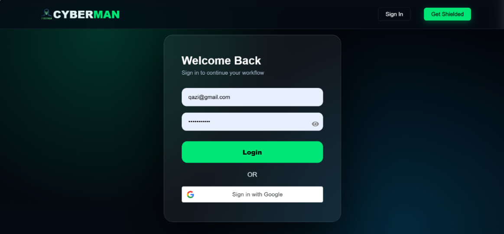
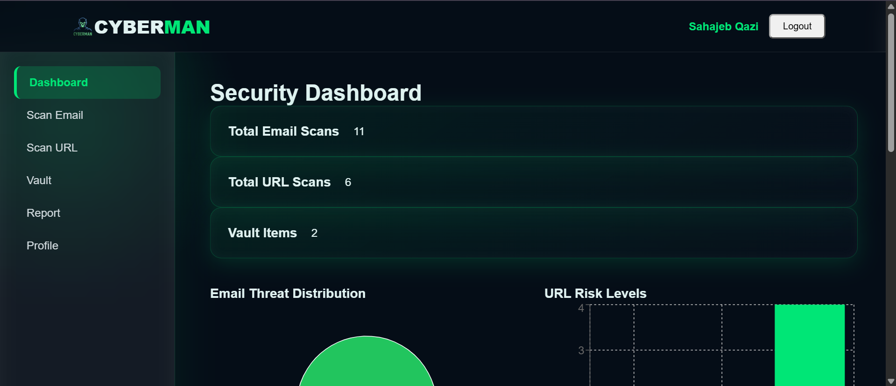
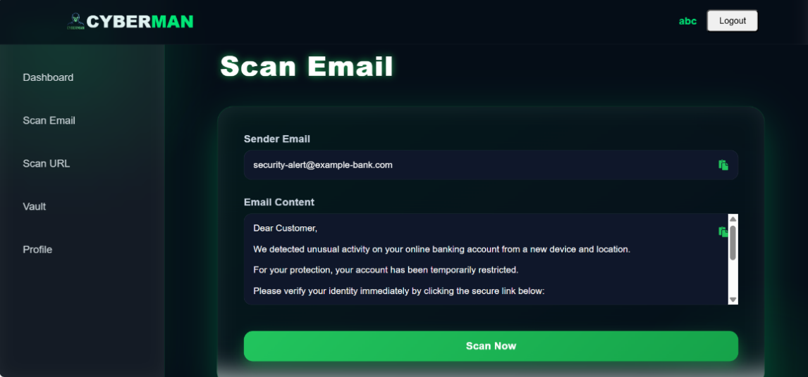
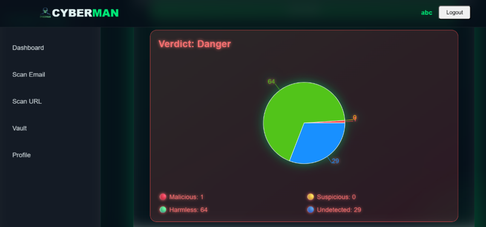
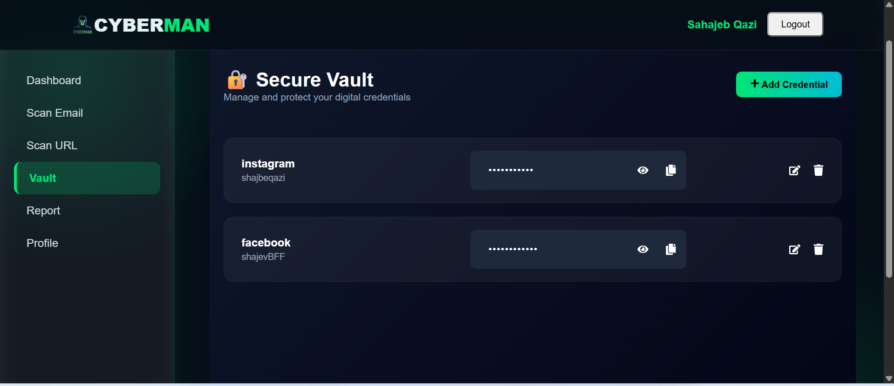
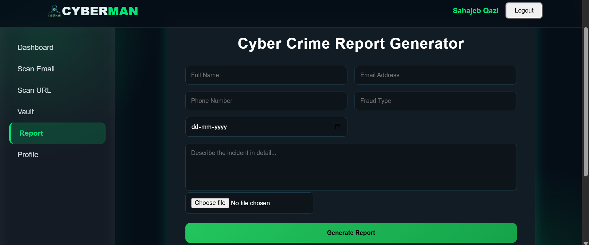
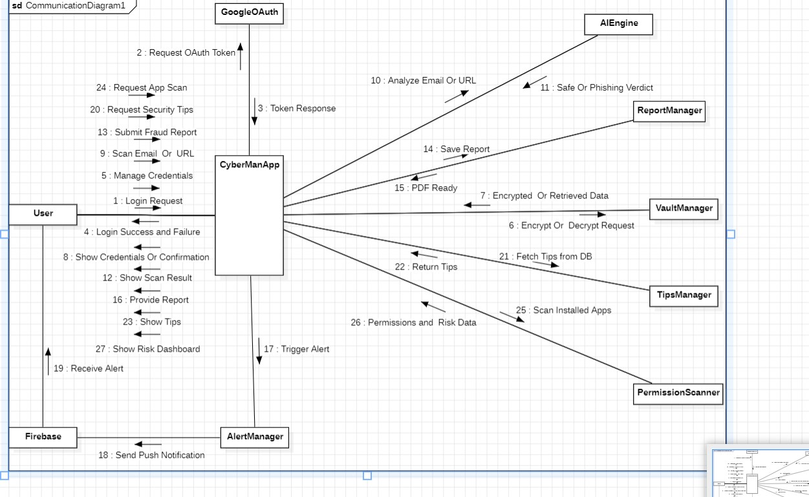

# CyberMan — AI-Driven Cybersecurity Platform

> Scan suspicious emails and links, store passwords in an encrypted vault, and generate a cyber crime complaint PDF — all in one web application.

**CyberMan is a final-year student project. It currently runs locally and is not deployed.**

## Overview

CyberMan helps users identify potential phishing threats by combining machine-learning predictions with rule-based checks. Users can sign in, scan email content and URLs, view security results, store passwords in an encrypted vault, and generate a cyber crime complaint PDF.

### System Components

- **Frontend:** React and Vite
- **Backend:** ASP.NET Core Web API with SQL Server
- **ML service:** Python, FastAPI, and a DistilBERT model
- **URL threat intelligence:** VirusTotal API

## Features

- **Authentication:** Email/password registration and login, plus optional Google sign-in using JWT.
- **Email scanning:** Combines the ML score with sender and link checks to classify messages as Safe, Suspicious, or Phishing.
- **URL scanning:** Uses VirusTotal to retrieve URL analysis and a risk rating.
- **Security dashboard:** Displays scan totals, charts, and recent scans.
- **Encrypted password vault:** Encrypts saved passwords with AES before storing them in the database.
- **Cyber crime report generator:** Creates a complaint PDF in the browser. The report is not automatically saved to a server or submitted to an authority.

## Screenshots

Make sure the image files exist in the `screenshots/` directory and that their names match the paths below. GitHub paths are case-sensitive.

### Authentication and Dashboard

| Login | Dashboard |
|---|---|
|  |  |

### Threat Scanning

| Email Scan | URL Scan |
|---|---|
|  |  |

### Other Features

| Secure Vault | Cyber Crime Report Generator |
|---|---|
|  |  |

## Demo Video

[Watch the CyberMan Demo on YouTube](https://youtu.be/gSAut5xqTpQ)

## Technology Stack

| Component | Technologies |
|---|---|
| Frontend | React 19, Vite 7, React Router, Axios, Recharts, jsPDF |
| Backend | C#, .NET 8, ASP.NET Core Web API, Identity, JWT, Entity Framework Core |
| Database | Microsoft SQL Server |
| Machine Learning | Python, PyTorch, Hugging Face Transformers, DistilBERT, FastAPI |
| External Services | VirusTotal API, Google Sign-In |

## Architecture

Add your flowchart image to the repository and update the path below to match its actual location. For example, save it as `docs/architecture.png`.



### Email Scanning Flow

1. The frontend sends the sender information and email content to the ASP.NET Core API.
2. The API forwards the scan request to the FastAPI ML service.
3. The ML service combines its model prediction with sender and link rules.
4. The backend stores the scan result and returns it to the frontend.

The documented risk score uses these weights:

- **50%** — ML score
- **25%** — Sender rules
- **25%** — Link rules

### URL Scanning Flow

1. The frontend submits a URL to the ASP.NET Core API.
2. The API requests an analysis from VirusTotal.
3. The backend retrieves the analysis result, saves it, and returns the risk rating.

URL scans use VirusTotal rather than the email ML model. Analysis may take up to approximately 48 seconds, depending on the service response.

## Project Structure

```text
CyberMan/
├── frontend/       # React and Vite application
├── backend/        # ASP.NET Core Web API
├── ML_model/       # FastAPI service, model and related files
├── screenshots/    # Screenshots used in this README
├── docs/           # Project documentation and architecture image
└── README.md
```

## Getting Started

### Prerequisites

Install the following tools and services:

- [Git](https://git-scm.com/)
- [Git LFS](https://git-lfs.com/)
- [.NET 8 SDK](https://dotnet.microsoft.com/download/dotnet/8.0)
- [Node.js](https://nodejs.org/) 20.19+ or 22.12+
- Python 3
- SQL Server (SQL Server Express is sufficient)
- A VirusTotal API key

### 1. Clone the Repository

```powershell
git lfs install
git clone https://github.com/Sahajeb/CyberMan.git
cd CyberMan
```

### 2. Start the ML Service

Open a terminal in the repository root and run:

```powershell
cd ML_model
python -m venv .venv
.\.venv\Scripts\Activate.ps1
pip install fastapi "uvicorn[standard]" torch transformers
python run.py
```

The service is expected to run at `http://127.0.0.1:8000`. Open `http://127.0.0.1:8000/docs` to inspect its API documentation.

If PowerShell blocks virtual-environment activation, check your local execution policy or activate the environment using a supported alternative for your Python installation.

### 3. Configure and Start the Backend

Open a **second terminal** in the repository root:

```powershell
cd backend
dotnet user-secrets init
```

Configure the required secrets. Replace the placeholders with your own values:

```powershell
dotnet user-secrets set "ConnectionStrings:DefaultConnection" "YOUR_SQL_SERVER_CONNECTION_STRING"
dotnet user-secrets set "Jwt:Key" "YOUR_LONG_RANDOM_SIGNING_KEY"
dotnet user-secrets set "VaultSettings:EncryptionKey" "YOUR_BASE64_32_BYTE_KEY"
dotnet user-secrets set "VirusTotal:ApiKey" "YOUR_VIRUSTOTAL_API_KEY"
dotnet user-secrets set "Google:ClientId" "YOUR_GOOGLE_CLIENT_ID"
```

The vault encryption key must decode from Base64 to exactly 32 bytes. Use strong, unique secrets and never commit real secret values.

Install the EF Core CLI tool if it is not already installed:

```powershell
dotnet tool install --global dotnet-ef
```

Then apply the database migrations and start the API:

```powershell
dotnet ef database update
dotnet dev-certs https --trust
dotnet run --launch-profile https
```

If `dotnet-ef` is already installed, update it rather than installing it again.

The API is expected to run at `https://localhost:7180`, with Swagger at `https://localhost:7180/swagger`, according to the project's current configuration. Confirm the actual port in `backend/Properties/launchSettings.json`.

### 4. Start the Frontend

Open a **third terminal** in the repository root:

```powershell
cd frontend
npm install
npm run dev
```

Open `http://localhost:5173` in your browser and register an account.

The API base URL is configured in `frontend/src/api/api.js`, and the Google client ID is configured in `frontend/src/main.jsx`.

## Configuration Reference

| Setting | Purpose |
|---|---|
| `ConnectionStrings:DefaultConnection` | SQL Server connection string |
| `Jwt:Key` | Signs authentication tokens |
| `VaultSettings:EncryptionKey` | Encrypts vault passwords |
| `VirusTotal:ApiKey` | Enables VirusTotal URL analysis |
| `Google:ClientId` | Enables Google sign-in |

Use .NET User Secrets during local development or environment variables in other environments. ASP.NET Core environment-variable names use double underscores, for example `Jwt__Key`.

**Never commit API keys, database passwords, JWT signing keys, or vault encryption keys.** Do not expose private API secrets in frontend code.

## API Endpoints

The following endpoints reflect the project's documented API contract. Verify route casing and authorization behavior against the implementation.

| Method | Endpoint | Purpose | Authentication |
|---|---|---|---|
| `POST` | `/api/auth/register` | Register an account | No |
| `POST` | `/api/auth/login` | Sign in | No |
| `POST` | `/api/auth/google` | Google sign-in | No |
| `GET` | `/api/auth/me` | Get the current user | Yes |
| `POST` | `/api/scan` | Scan email content | Yes |
| `POST` | `/api/Url/scan` | Scan a URL | Yes |
| `GET` | `/api/dashboard` | Retrieve dashboard data | Yes |
| `GET`, `POST` | `/api/vault` | List or add vault entries | Yes |
| `PUT`, `DELETE` | `/api/vault/{id}` | Update or delete a vault entry | Yes |

The ML service exposes `POST /scan` for email analysis. It is an internal service and should not be exposed publicly without appropriate authentication and access controls.

## Known Limitations

- The model was trained on a small dataset of 5,169 short, SMS-style messages.
- Model accuracy has not been independently measured, so no accuracy figures are claimed.
- Predictions can be wrong. Treat results as guidance, not proof that a message is safe or malicious.
- The API URL, ML service URL, and CORS origin are configured for local development.
- URL scanning depends on VirusTotal availability and API rate limits.
- A `requirements.txt` file and automated tests are not currently included.
- The scan-history feature is limited to the dashboard's recent-scan information; there is no dedicated full history page.
- The complaint PDF is generated in the browser and is not automatically submitted to a cyber crime authority.

## Troubleshooting

- **Frontend cannot reach the API:** Start the backend with the HTTPS launch profile and confirm the API port matches `frontend/src/api/api.js`.
- **CORS error:** Check that the frontend origin matches the origin allowed by the backend. The current configuration expects `http://localhost:5173`.
- **Model file is unexpectedly small:** Run `git lfs pull` from the repository root to retrieve Git LFS-managed files.
- **ML service cannot find the model:** Start the service from the expected `ML_model` directory and verify the model file paths.
- **Database connection fails:** Verify that SQL Server is running, the instance name is correct, and the connection string has valid credentials or Windows authentication settings.
- **URL scan takes a long time:** VirusTotal analysis can take time and may be constrained by the API plan's rate limits.

## Author

**Sahajeb Qazi**

- GitHub: [github.com/Sahajeb](https://github.com/Sahajeb)

## License

No license has been selected for this project yet. Until a license is added, others should not assume they have permission to redistribute or reuse the code.
